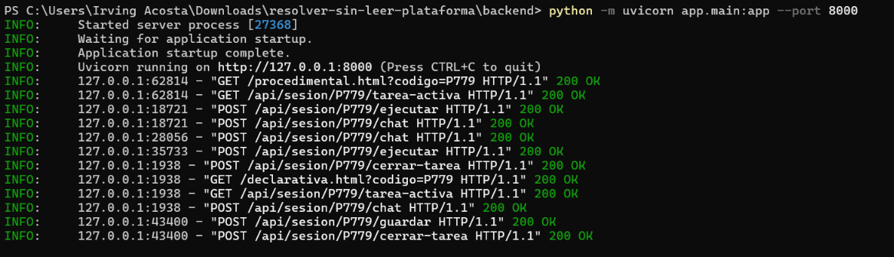
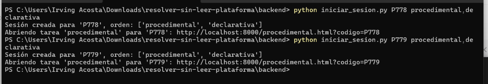
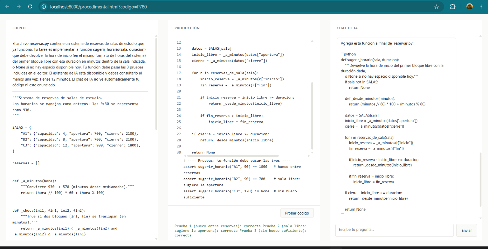
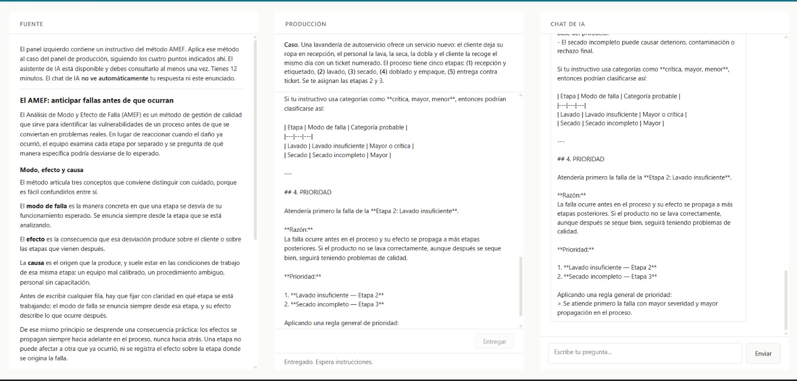
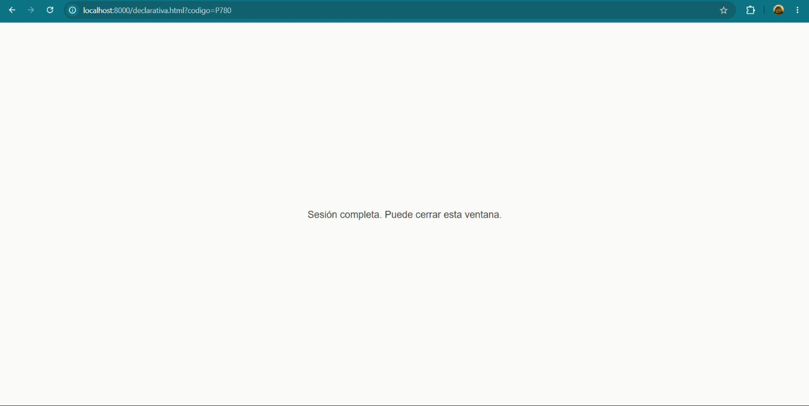
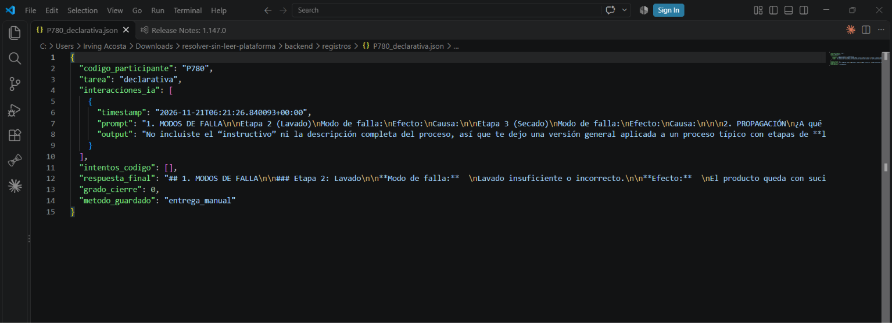
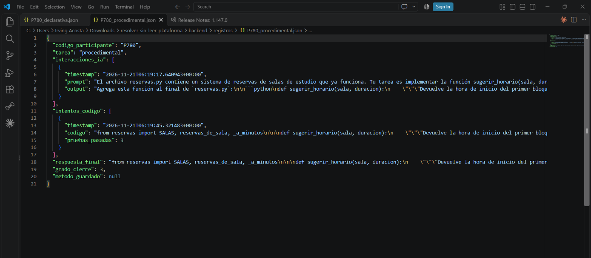
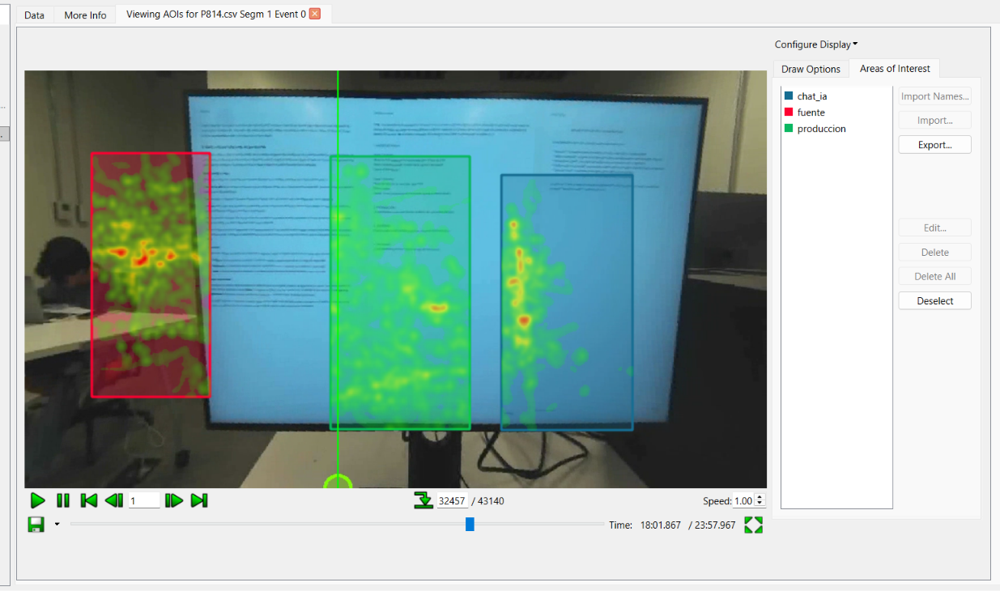
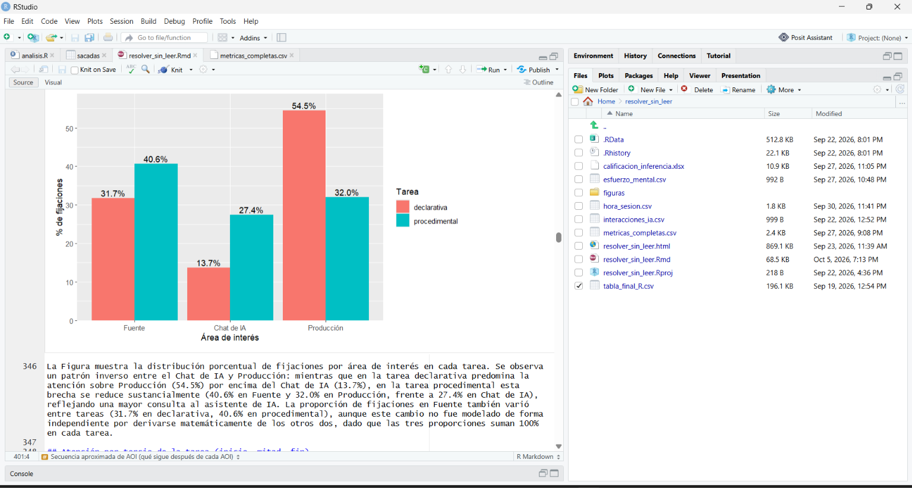
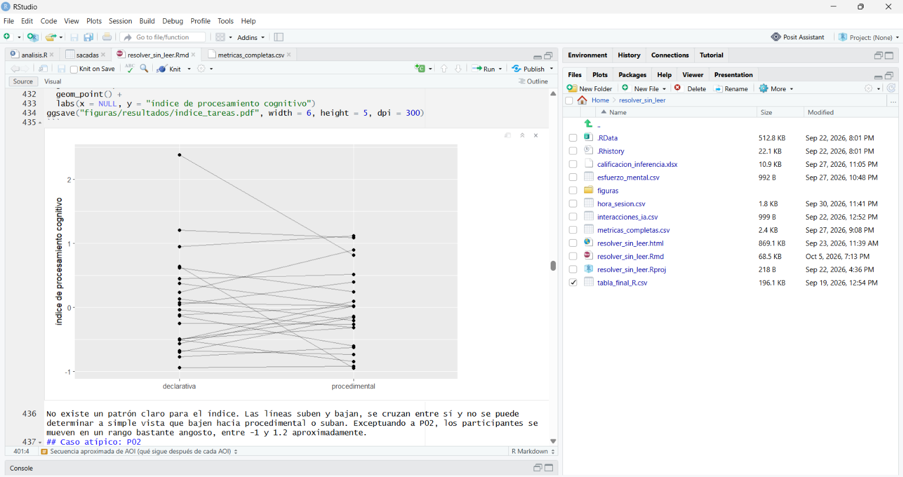

# Resolver sin leer

**Análisis comparativo del procesamiento cognitivo en tareas procedimentales y declarativas asistidas por Inteligencia Artificial Generativa**

Trabajo de graduación — Licenciatura en Ingeniería en Ciencias de la Computación y Tecnologías de la Información, Universidad del Valle de Guatemala, 2026.

## Descripción

La inteligencia artificial generativa (GenAI) cambió el flujo de trabajo académico: de leer, comprender y resolver, a formular un *prompt*, leer una respuesta y aplicarla. Esto favorece la rendición cognitiva, en la que el estudiante adopta la respuesta sin analizarla.

Este estudio comparó el procesamiento cognitivo de 24 estudiantes de tercer año de Ingeniería en Ciencias de la Computación y TI al resolver una tarea **declarativa** (aplicar el método AMEF a un caso) y una **procedimental** (completar una función en Python) asistidas por GenAI. Se registraron fijaciones, sacadas y diámetro pupilar con un dispositivo de rastreo ocular (*eye tracking*), en un diseño intra-sujeto con contrabalanceo.

El repositorio contiene dos componentes:

1. **Plataforma experimental** (`src/plataforma`): aplicación web local en la que cada participante resolvió las dos tareas. La pantalla se divide en tres Áreas de Interés (AOI) de igual tamaño y sin scroll de página: **Fuente**, **Producción** y **Chat de IA**. Registra las interacciones con la IA y la respuesta final de cada participante.
2. **Análisis estadístico** (`src/analisis`): documento R Markdown con el análisis exploratorio, los modelos de efectos mixtos, las correlaciones de Spearman y las pruebas de Wilcoxon reportadas en el informe.

## Tecnologías Utilizadas

**Plataforma experimental**
- Python 3.10+
- FastAPI + Uvicorn (backend y servidor del frontend)
- HTML, CSS y JavaScript (frontend estático)
- API de OpenAI (chat de IA)

**Análisis estadístico**
- R + R Markdown
- Paquetes: `tidyverse`, `lmerTest`, `readxl`, `pwr`, `MASS`

## Requisitos Previos

- Python 3.10 o superior
- Una API key de OpenAI (solo necesaria para que funcione el chat; el resto de la plataforma funciona sin ella)
- R 4.x y RStudio (para el análisis)

## Instalación

### 1. Clonar el repositorio

```bash
git clone https://github.com/wwIrvingww/2026-22781-morales-acosta-irving-fabricio.git
cd 2026-22781-morales-acosta-irving-fabricio
```

### 2. Instalar dependencias de la plataforma

```bash
cd src/plataforma/backend
pip install -r requirements.txt
```

### 3. Configurar variables de entorno

Copiar el archivo de ejemplo a `src/plataforma/backend/.env` y colocar la API key:

```bash
cp ../../.env.example .env
```

```
OPENAI_API_KEY=sk-...
```

El modelo y la temperatura se configuran en `src/plataforma/backend/app/config.py`.

## Ejecución

### Plataforma experimental

Desde `src/plataforma/backend/`:

```bash
# Terminal 1: levantar el servidor
python -m uvicorn app.main:app --port 8000

# Terminal 2: iniciar la sesión de un participante (código y orden contrabalanceado)
python iniciar_sesion.py P07 procedimental,declarativa
```

Se abre el navegador en la tarea correspondiente. Para cerrar la tarea activa se usa `Ctrl + Shift + Alt + C` en la pantalla del participante. Los datos se guardan en `backend/sesiones/` y `backend/registros/` (identificados solo por el código del participante).

La documentación detallada de la plataforma está en [`src/plataforma/README.md`](src/plataforma/README.md).

### Análisis estadístico

Abrir `src/analisis/resolver_sin_leer.Rmd` en RStudio, con `src/analisis/` como directorio de trabajo, y ejecutar **Knit**.

Datos incluidos (anonimizados, solo códigos de participante):
- `tabla_final_R.csv`: fijaciones por participante, tarea y AOI.
- `calificacion_inferencia.xlsx`: respuestas y puntajes de las preguntas de inferencia.

No se incluyen en este repositorio los archivos `interacciones_ia.csv`, `esfuerzo_mental.csv`, `metricas_completas.csv` ni `hora_sesion.csv`, por lo que las secciones del análisis que los usan no se pueden ejecutar con los datos publicados.

## Estructura del Repositorio

```
├── capturas/      Capturas de pantalla del sistema
├── demo/          Video demostrativo
├── docs/          Informe final y consentimiento firmado
├── src/
│   ├── .env.example
│   ├── plataforma/    Plataforma experimental (FastAPI + HTML/JS)
│   └── analisis/      Análisis estadístico en R y datos anonimizados
└── README.md
```

## Capturas

Las capturas del sistema se encuentran en la carpeta [`/capturas`](capturas/):

| | |
|---|---|
|  |  |
|  |  |
|  |  |
|  |  |
|  |  |

## Demo

Video demostrativo: [`/demo/demo.mp4`](demo/demo.mp4)

## Documentación

- Informe final: [`/docs/informe_final.pdf`](docs/informe_final.pdf)
- Consentimiento de uso de foto y video: [`/docs/consentimiento_firmado.pdf`](docs/consentimiento_firmado.pdf)

## Autores

- **Irving Fabricio Morales Acosta** — Carné 22781
- Asesor: Dennis Aldana Moscoso

## Licencia

Proyecto académico desarrollado como trabajo de graduación en la Universidad del Valle de Guatemala.
